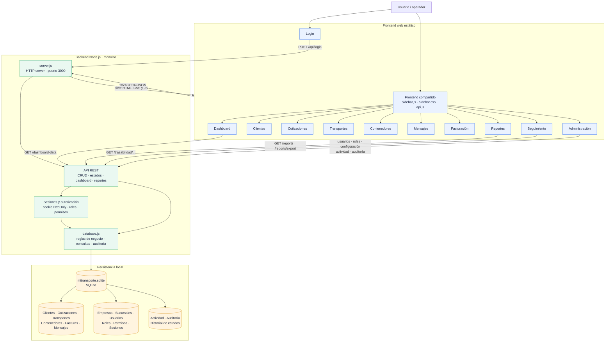
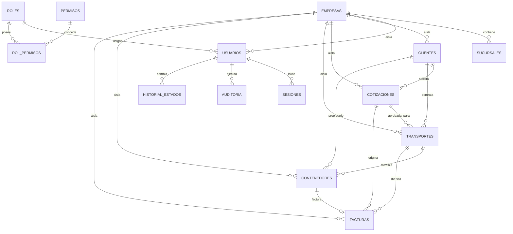
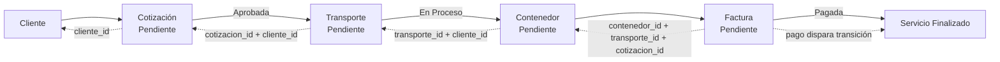

# Arquitectura de MiTransporte IA

## Diagrama de arquitectura

### Relaciones principales

Las tablas operativas mantienen algunas columnas de texto históricas (`cliente`,
por ejemplo), pero las altas nuevas usan las referencias `*_id`. El aislamiento
SaaS se aplica mediante `empresa_id`; las relaciones de sucursal usan
`sucursal_id` en los módulos operativos.

## Flujo operativo

El backend valida el avance secuencial de estados. Una cotización inicia en
`Pendiente`, el transporte requiere una cotización `Aprobado`, el contenedor
requiere un transporte `En Proceso` o `Finalizado`, y la factura requiere un
contenedor asociado a un transporte operativo. El pago de una factura
`Pagada` finaliza el transporte y el contenedor relacionados. Cada alta y
transición se registra en `historial_estados` y `auditoria`.

## Diagnóstico de arquitectura

### Fortalezas

- **Flujo de negocio explícito:** las reglas de cotización, transporte,
  contenedor y factura están centralizadas en `database.js`, evitando que el
  frontend sea la única barrera.
- **Trazabilidad:** auditoría, actividad, historial de estados y endpoint de
  trazabilidad permiten reconstruir el ciclo de un servicio.
- **Seguridad funcional básica:** sesiones persistidas, cookies `HttpOnly`,
  hash con `scrypt`, roles, permisos de lectura/gestión y aislamiento por
  `empresa_id`.
- **Cobertura operativa:** dashboard, reportes filtrables, exportación CSV/
  Excel/PDF, facturación y seguimiento están integrados en el mismo flujo.
- **Simplicidad de despliegue:** frontend y API son servidos por el mismo
  proceso y SQLite elimina dependencias externas para un entorno pequeño.

### Debilidades

- **Monolito altamente acoplado:** `server.js` mezcla enrutamiento, entrega de
  archivos y control de acceso; `database.js` concentra esquema, migraciones,
  consultas y reglas de dominio.
- **Ausencia de contrato formal:** no se observan `package.json`, OpenAPI,
  validación de esquemas compartida ni pruebas automatizadas en el repositorio.
- **Persistencia limitada:** SQLite en un archivo local no ofrece por sí solo
  alta disponibilidad, escalado horizontal ni operación multiinstancia.
- **Frontend sin capa de componentes:** páginas HTML con JavaScript embebido
  duplican renderizado, validaciones y manejo de errores.
- **Migraciones implícitas:** el esquema se modifica al arrancar mediante
  `ALTER TABLE` y reconstrucción de tablas, sin versiones ni historial de
  migraciones reproducible.
- **Semántica de datos heredada:** conviven nombres de cliente en texto con
  relaciones por ID, lo que aumenta el riesgo de inconsistencias históricas.

### Riesgos

- **Continuidad operativa:** corrupción, pérdida o bloqueo del archivo SQLite
  puede afectar simultáneamente a todos los módulos y empresas.
- **Escalabilidad:** reportes agregados y dashboard ejecutan consultas sobre la
  base transaccional; el crecimiento puede degradar latencia y bloquear escrituras.
- **Exposición de autenticación:** la contraseña inicial de desarrollo
  (`admin123`) y la ausencia visible de rate limiting, MFA y política de
  expiración avanzada elevan el riesgo si se despliega sin endurecimiento.
- **Integridad multiempresa:** cada consulta nueva debe aplicar el filtro de
  tenant; una omisión en una futura ruta podría exponer datos entre empresas.
- **Protección de API:** debe añadirse una estrategia explícita de CSRF,
  cabeceras de seguridad, límites de petición y observabilidad antes de
  exponerlo públicamente.
- **Evolución del dominio:** facturación, pagos, proveedores, vehículos,
  tarifas e impuestos todavía no forman subdominios independientes.

### Oportunidades de mejora

- Extraer módulos de rutas, middleware de autenticación/autorización,
  validadores y servicios de dominio desde `server.js`.
- Definir contratos OpenAPI y esquemas de entrada/salida con validación
  reutilizable; añadir pruebas unitarias, integración y flujo end-to-end.
- Introducir migraciones versionadas, constraints explícitas, claves únicas
  de negocio y una estrategia de backup/restore probada.
- Preparar un adaptador de persistencia y migrar a PostgreSQL cuando haya
  concurrencia, volumen o necesidades de alta disponibilidad.
- Unificar el frontend en componentes reutilizables con estado, routing,
  tablas paginadas y manejo centralizado de errores.
- Añadir observabilidad: logs estructurados, métricas, trazas, alertas y
  correlación por solicitud/empresa/usuario.

## Roadmap profesional hacia una plataforma SaaS logística

### Línea base actual

MiTransporte IA ya es un **MVP operativo**, no una plataforma SaaS lista para
producción masiva. El núcleo funcional existente incluye:

| Capacidad | Estado actual | Evidencia |
|---|---|---|
| Frontend web y navegación | Implementado | Páginas HTML por módulo, `sidebar.js` y `api.js` |
| Clientes, cotizaciones, transportes, contenedores y mensajes | Implementado | CRUD REST y pantallas operativas |
| Flujo de estados | Implementado | Validación secuencial en `database.js` |
| Facturación y pago | Implementado | Facturas vinculadas a contenedor, transporte y cotización |
| Dashboard y reportes | Implementado | KPIs, filtros y exportación CSV/Excel/PDF |
| Login y sesiones | Implementado | Sesiones SQLite, cookie `HttpOnly`, hash `scrypt` |
| Roles y permisos | Implementado | Administrador, Operador, Comercial y Consulta |
| Multiempresa básico | Implementado parcialmente | `empresa_id`, empresas, sucursales y filtros por tenant |
| Auditoría y trazabilidad | Implementado | Auditoría, actividad e historial de estados |
| API documentada y versionada | Falta | No existe contrato OpenAPI ni versionado `/api/v1` |
| Pruebas automatizadas y CI/CD | Falta | No se observan suites ni pipeline en el repositorio |
| Alta disponibilidad y escalado | Falta | SQLite local y proceso único Node.js |
| Integraciones externas | Falta | No hay webhooks, proveedores, pagos ni operadores conectados |
| Analítica predictiva/IA | Falta | Dashboard descriptivo, sin modelos predictivos |

### Criterio de prioridad

- **P0:** bloquea seguridad, continuidad o la capacidad de vender el producto.
- **P1:** aumenta significativamente la eficiencia o el valor del ERP.
- **P2:** diferenciación, optimización o expansión posterior.

### Fase 1 — Productización y confiabilidad del MVP

**Objetivo:** convertir el prototipo funcional actual en una primera versión
segura, testeable y operable para clientes piloto.

| Trabajo | Situación | Prioridad | Impacto empresarial | Complejidad |
|---|---|---:|---|---:|
| Migraciones versionadas, constraints, índices y backup/restore probado | Falta; hoy el esquema se altera al arrancar | P0 | Muy alto: evita pérdida e inconsistencias | Media |
| Separar `server.js` en router, middleware, controladores y servicios | Falta; el servidor concentra responsabilidades | P0 | Alto: reduce riesgo de cambios | Media |
| OpenAPI, validación de payloads y errores con contrato estable | Falta | P0 | Alto: acelera integraciones y soporte | Media |
| Pruebas unitarias de reglas y E2E del flujo completo | Falta | P0 | Muy alto: protege la facturación y operación | Media |
| Rate limiting, CSRF, cabeceras seguras, timeout y límites uniformes | Falta parcialmente | P0 | Muy alto: reduce exposición pública | Media |
| Eliminar credenciales predeterminadas y añadir MFA opcional | Parcial; existe contraseña de desarrollo configurable | P0 | Muy alto: evita accesos no autorizados | Media |
| Logs estructurados, correlation ID, health checks y métricas básicas | Falta | P1 | Alto: reduce tiempo de diagnóstico | Baja/Media |
| Frontend con componentes compartidos, paginación y errores consistentes | Parcial; hay HTML/JS repetido | P1 | Medio/alto: mejora productividad del usuario | Media |

**Resultado esperado:** versión piloto con un único tenant o pocos tenants,
SLA operativo básico, recuperación documentada y regresión controlada.

### Fase 2 — ERP logístico comercial completo

**Objetivo:** ampliar el alcance desde el seguimiento básico del servicio a la
gestión integral de la operación logística y financiera.

| Trabajo | Situación | Prioridad | Impacto empresarial | Complejidad |
|---|---|---:|---|---:|
| Catálogo de servicios, tarifas, zonas, monedas, impuestos y descuentos | Falta | P0 | Muy alto: cotizaciones consistentes y margen visible | Media |
| Proveedores, vehículos, conductores y disponibilidad | Falta | P1 | Muy alto: planificación y control de costos | Alta |
| Planificación de rutas, hitos, ETA y evidencias de entrega | Falta | P1 | Muy alto: menor demora y mejor servicio | Alta |
| Documentos operativos, adjuntos y control de vencimientos | Falta | P1 | Alto: menos errores y mejor cumplimiento | Media |
| Cuentas por cobrar/pagar, notas de crédito y conciliación | Parcial; existe factura básica | P0 | Muy alto: ciclo financiero completo | Alta |
| CRM de mensajes, plantillas, notificaciones y portal de cliente | Parcial; mensajes son CRUD | P1 | Alto: retención y comunicación proactiva | Media/Alta |
| Catálogo de estados/eventos configurable por empresa | Parcial; estados están codificados | P1 | Medio/alto: adapta el producto a distintos operadores | Media |

**Resultado esperado:** ERP logístico con rentabilidad por servicio, control de
recursos, documentos y comunicación con el cliente.

### Fase 3 — SaaS multiempresa escalable

**Objetivo:** pasar de una aplicación local multiempresa a un servicio SaaS
aislado, observable y capaz de crecer sin degradar la operación.

| Trabajo | Situación | Prioridad | Impacto empresarial | Complejidad |
|---|---|---:|---|---:|
| Migrar persistencia a PostgreSQL mediante un adaptador compatible | Falta; SQLite es local | P0 | Muy alto: concurrencia, disponibilidad y crecimiento | Alta |
| Tenant isolation centralizado y pruebas de no fuga entre empresas | Parcial; depende de filtros por consulta | P0 | Crítico: requisito de confianza y cumplimiento | Alta |
| API `/api/v1`, webhooks, idempotencia y límites por tenant | Falta | P0 | Alto: integraciones fiables y monetizables | Media/Alta |
| Colas para exportaciones, notificaciones y tareas largas | Falta | P1 | Alto: evita bloquear solicitudes web | Media |
| Almacenamiento de objetos para documentos y backups cifrados | Falta | P1 | Alto: continuidad y escalabilidad | Media |
| Separar reporting/BI de la base transaccional | Falta | P1 | Alto: reportes rápidos sin afectar operación | Alta |
| SSO/OIDC, MFA obligatoria por política, SCIM y auditoría de seguridad | Falta | P1 | Alto: clientes corporativos y compliance | Alta |
| Billing SaaS, planes, límites, trial y administración de suscripciones | Falta | P0 | Muy alto: permite vender el producto | Media/Alta |
| CI/CD, infraestructura como código, staging y despliegues reversibles | Falta | P0 | Muy alto: entregas seguras y repetibles | Media/Alta |

**Resultado esperado:** plataforma SaaS multi-tenant con onboarding, planes,
aislamiento verificable, backups, observabilidad y despliegues sin
interrupciones relevantes.

### Fase 4 — Inteligencia, ecosistema y optimización

**Objetivo:** diferenciar la plataforma y convertir datos operativos en
decisiones accionables, sin introducir IA antes de tener datos confiables.

| Trabajo | Situación | Prioridad | Impacto empresarial | Complejidad |
|---|---|---:|---|---:|
| Modelo analítico de costos, tiempos, demanda y rentabilidad | Falta | P1 | Muy alto: decisiones basadas en margen y capacidad | Alta |
| Pronóstico de demanda, ETA y riesgo de retraso | Falta | P1 | Alto: mejor utilización y promesas más precisas | Alta |
| Detección de anomalías en costos, estados y facturas vencidas | Falta | P1 | Alto: prevención de pérdidas | Media/Alta |
| Asistente operacional con permisos, fuentes y trazabilidad | Falta | P2 | Alto: menor tiempo de consulta y soporte | Alta |
| Marketplace/API de integraciones con aduanas, GPS, pagos y carriers | Falta | P1 | Muy alto: efecto de red y expansión comercial | Alta |
| Optimización de rutas y asignación de recursos | Falta | P2 | Muy alto: ahorro directo por operación | Muy alta |

**Resultado esperado:** plataforma con inteligencia operacional explicable,
integraciones de ecosistema y optimización medible de costos, tiempos y nivel
de servicio.

## Secuencia recomendada de ejecución

1. **No comenzar por microservicios ni IA.** Primero estabilizar contratos,
   seguridad, pruebas y modelo de datos.
2. **Mantener compatibilidad de API** mientras se extraen servicios internos;
   la migración debe ser incremental, no un reemplazo total.
3. **Priorizar el camino de dinero:** cotización, aprobación, transporte,
   evidencia, factura, pago y conciliación.
4. **Migrar a PostgreSQL cuando existan métricas que lo justifiquen**, pero
   diseñar desde Fase 1 un repositorio desacoplado para que el cambio no
   afecte al frontend.
5. **Convertir cada fase en un gate de negocio:** seguridad y recuperación
   antes de pilotos; rentabilidad antes de expansión; aislamiento y billing
   antes de SaaS abierto; datos confiables antes de IA.

## KPIs de salida por fase

| Fase | Indicadores recomendados |
|---|---|
| 1 | Cobertura de reglas críticas, tasa de errores, RTO/RPO probado, vulnerabilidades P0/P1 cerradas |
| 2 | Tiempo de cotización, margen por servicio, entregas a tiempo, facturas vencidas, utilización de recursos |
| 3 | Disponibilidad, latencia p95, tenants activos, costo por tenant, tasa de onboarding, incidentes de aislamiento |
| 4 | Precisión de ETA/demanda, ahorro por optimización, adopción del asistente, ingresos de integraciones |

## Evidencia principal

- Backend y servidor: [`backend/server.js`](./backend/server.js)
- Esquema, reglas y acceso a datos: [`backend/database.js`](./backend/database.js)
- Cliente HTTP del frontend: [`frontend/api.js`](./frontend/api.js)
- Navegación y permisos de pantalla: [`frontend/sidebar.js`](./frontend/sidebar.js)
- Persistencia y relaciones documentadas: [`README.md`](./README.md)
